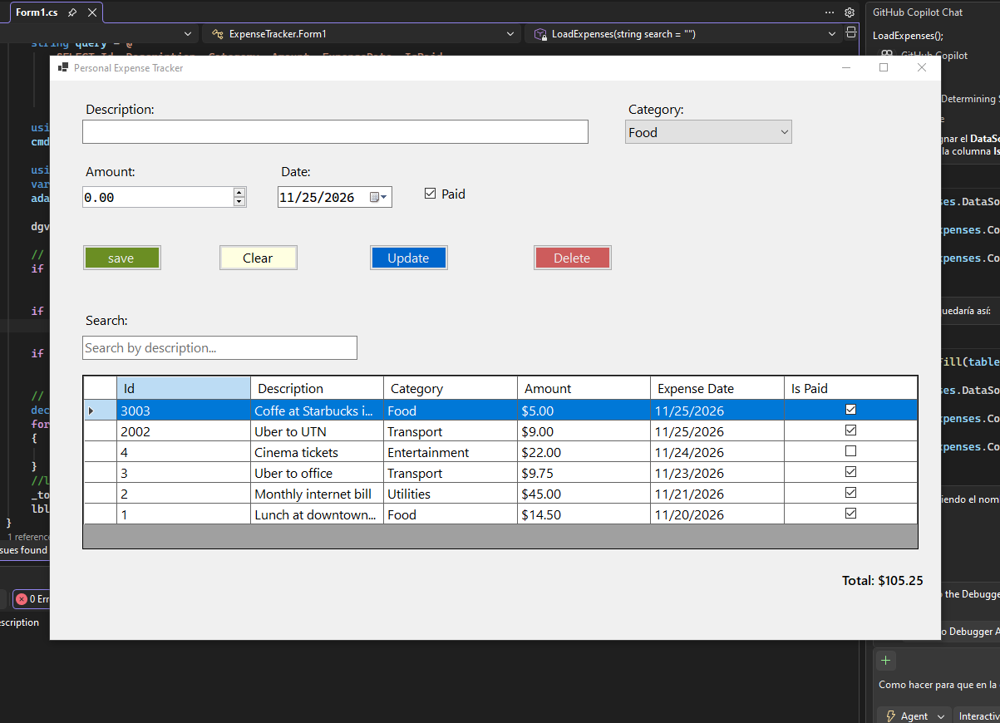
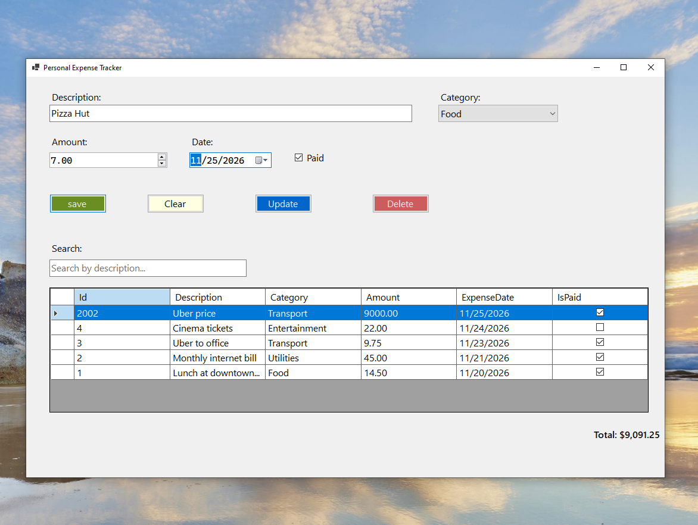
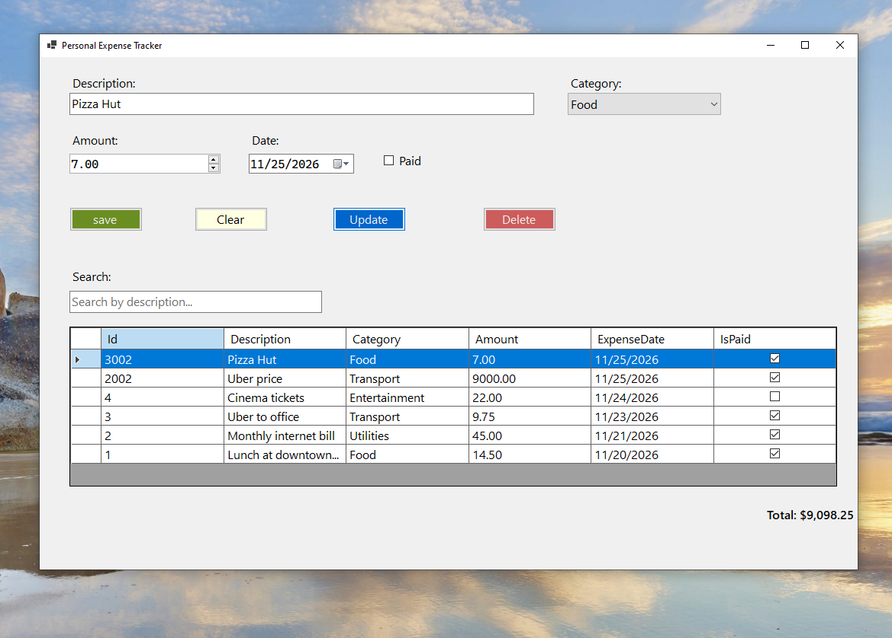
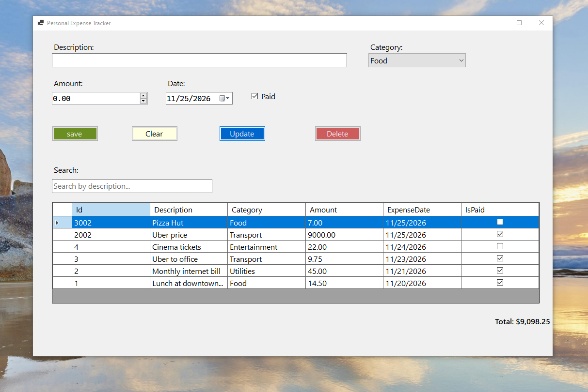
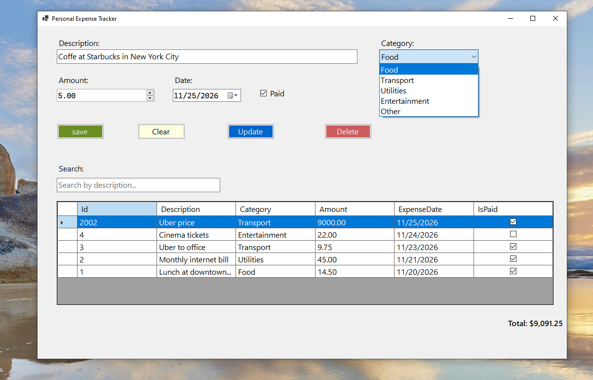
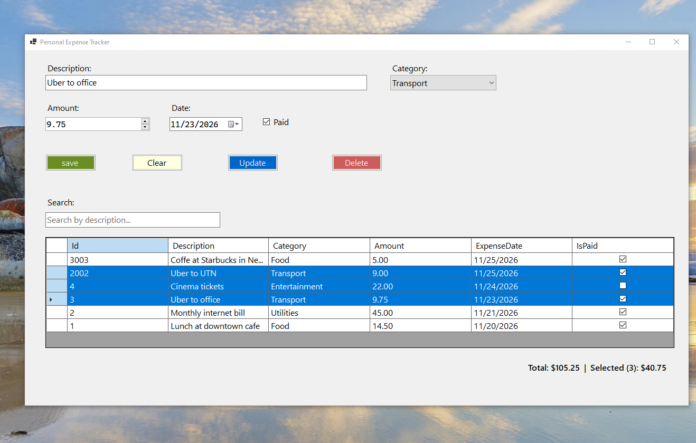

# Personal Expense Tracker (WinForms + SQL Server)

A short hands-on C# Windows Forms and Microsoft SQL Server project focused on understanding WinForms' event-driven model and basic CRUD operations using ADO.NET (`Microsoft.Data.SqlClient`).



## Features
- **Create** expenses with description, category, amount, date and paid status.
- **Update** and **Delete** (with confirmation) the selected expense.
- **Live search** by description as you type.
- **Running total** of all expenses, plus a **subtotal of the selected rows** (multi-select).
- Amounts formatted as currency in the grid.
- All queries are parameterized (`INSERT`, `SELECT`, `UPDATE`, `DELETE`) to prevent SQL injection.

## Learning Objectives
- Handle core WinForms events (`Load`, `Click`, `CellClick`, `TextChanged`).
- Work with typed input controls (`TextBox`, `ComboBox`, `NumericUpDown`, `DateTimePicker`, `CheckBox`) and `DataGridView`.
- Execute parameterized SQL queries to prevent SQL injection.

## Tech Stack
- C# / .NET (Windows Forms)
- Microsoft SQL Server / LocalDB
- `Microsoft.Data.SqlClient`

## Screenshots

### 1. Adding an expense
Fill in the form and press **save**; the new row appears at the top of the grid and the total updates.



### 2. Editing an existing expense
Click a row to load it into the form, change a field (here, unchecking **Paid**) and press **Update**.



### 3. Update reflected in the grid
The grid refreshes after the update: the `IsPaid` checkbox is now cleared and the form resets.



### 4. Categories
The category `ComboBox` offers Food, Transport, Utilities, Entertainment and Other.



### 5. Subtotal of selected rows
Select several rows (Ctrl/Shift + click) and the footer shows both the overall total and the subtotal of the selection.



### 6. Currency formatting
`Amount` is displayed as currency and the column headers are spaced for readability.


## Database Setup
Run the following script in SQL Server Management Studio (SSMS) or Azure Data Studio before launching the app:

```sql
CREATE DATABASE PracticeDB;
GO

USE PracticeDB;
GO

CREATE TABLE Expenses (
    Id INT IDENTITY(1,1) PRIMARY KEY,
    Description NVARCHAR(120) NOT NULL,
    Category NVARCHAR(50) NOT NULL,
    Amount DECIMAL(10, 2) NOT NULL,
    ExpenseDate DATE NOT NULL,
    IsPaid BIT NOT NULL DEFAULT 1
);
```

## Running the App
1. Open `ExpenseTracker/ExpenseTracker.slnx` in Visual Studio 2022 17.13+ / 2026.
2. Check the connection string in `Form1.cs` matches your SQL Server / LocalDB instance.
3. Press **F5**.
